# Lumina Odonto — Fluxo de atendimento do MVP

**Especificação funcional para alinhamento da equipe — versão 0.4**

**Data:** 02/11/2026. **Decisor de produto:** Paulo Sérgio. **Finalidade:** orientar protótipo, contratos, modelagem e futuros testes. **Situação:** documento de alinhamento; não é aceite de implementação nem relatório de testes da Sprint 7.

**Base técnica consultada:** branch `chore/sprint-07-docker-integration`, HEAD `2f7dbfe6d0d7a747f57dbeeede3a716938adc5fa`, com alterações locais ainda sem commit. Os três pareceres recebidos foram revisões documentais, sem novos testes. A [especificação funcional 0.4](../fluxo-atendimento-mvp-2026-11-02.md) prevalece sobre versões anteriores; em especial, o fluxo de pagamento **não** exige novos campos de valor recebido e forma de pagamento.

## Sumário

1. Objetivo e limites do MVP
2. Atores e responsabilidades
3. Decisões aprovadas e legenda de situação
4. Sequência de uso e orientação ao protótipo
5. Seis fluxos visuais
6. API atual/local e lacunas
7. Critérios propostos para testes futuros
8. Decisões pendentes e próximos passos
9. Paralelismo de Argon2: sugestão para avaliação
10. Referências e rastreabilidade

## 1. Objetivo e limites do MVP

O fluxo pretendido começa no agendamento e na confirmação pela recepção, passa pelo atendimento do dentista, pelo registro clínico e pelo encaminhamento administrativo de serviços, e termina com a confirmação de pagamento pela recepção quando ele ocorrer fora da plataforma. O dentista também poderá consultar atendimentos realizados. O paciente participa **fora do sistema**: não há portal ou login do paciente neste recorte.

O documento define a direção funcional aprovada e mostra dependências técnicas ainda abertas. A existência de telas, tabelas SQL, fluxogramas ou relatos históricos não demonstra que o fluxo composto esteja implementado ou aceito. A conclusão da consulta, a finalização de uma evolução e a confirmação de pagamento são **três ações diferentes**. O pagamento não ocorre automaticamente ao concluir o atendimento.

O MVP não inclui integração com maquineta, processamento de cartão/Pix, parcelamento, caixa, emissão fiscal, portal do paciente, retificação clínica aprovada ou serviço de IA demonstrado. Uma lista de sugestões de serviços pode ser proposta no protótipo, mas catálogo completo e tabela automática de preços não são exigidos na versão 0.4.

## 2. Atores e responsabilidades

| Ator | Responsabilidade no fluxo pretendido | Limite de acesso |
| --- | --- | --- |
| Paciente | Solicita atendimento, comparece e paga fora da plataforma quando houver cobrança. | Participante externo; sem tela ou credencial. Pode existir consulta concluída com cobrança pendente. |
| Recepção | Agenda e confirma conforme permissões vigentes; consulta encaminhamento administrativo; confirma recebimento externo. | Não lê descrição da evolução, diagnóstico, `general_notes`, senha clínica ou histórico clínico por meio do encaminhamento. |
| Dentista | Seleciona consulta própria, usa senha principal e senha clínica pessoal, consulta histórico autorizado, salva evolução, informa itens ou Sem cobrança e conclui atendimento. | Senha clínica não cria vínculo; rascunhos de terceiros e edições comuns de registros finalizados continuam vedados. |
| Administrador | Atua na recuperação da senha clínica e é o responsável indicado por Paulo para corrigir serviços administrativos. | Não conhece a senha clínica definitiva nem ganha leitura de prontuário; limites de correção ainda são proposta técnica. |

O sistema valida e persiste operações; não é um quinto perfil humano. As respostas e mensagens de erro devem respeitar a clínica e o perfil, sem expor conteúdo clínico a funções administrativas.

## 3. Decisões aprovadas e legenda de situação

| Classificação usada neste documento | Significado |
| --- | --- |
| **Aprovado por Paulo** | Direção funcional definida; ainda não comprova código, execução ou aceite. |
| **Atual/local** | Comportamento encontrado no código publicado ou na árvore local; a parte local ainda precisa de commit, implantação e validação própria. |
| **Recomendação técnica** | Desenho proposto para contrato, transação ou segurança; não é regra técnica aprovada por extensão. |
| **Decisão pendente** | Escolha ainda necessária; o diagrama não decide em lugar de Paulo ou da equipe. |

**Aprovado por Paulo:** o dentista usa duas senhas pessoais, uma para login e outra para a área clínica; a segunda não é diferente por paciente nem substitui vínculo assistencial, autoria ou isolamento por clínica. A recuperação da senha clínica utiliza credencial temporária com validade e uso único, sem revelar a senha definitiva ao administrador. O dentista deve ter **evolução salva com descrição** antes de concluir a consulta; ela pode permanecer `DRAFT`, e não se cria nem finaliza automaticamente uma evolução para contornar a condição. Descrição vazia ou só com espaços não a satisfaz.

**Aprovado por Paulo:** ao concluir, o dentista informa itens administrativos com nome, quantidade e preço ou declara explicitamente **Sem cobrança**. Lista vazia não equivale a gratuidade. O pagamento ocorre fora da plataforma; a recepção apenas confirma no sistema que o recebimento ocorreu, registrando responsável e instante. A conclusão clínica não registra pagamento. Não exigir, neste recorte, novos campos de valor recebido e forma de pagamento. Paulo indicou o administrador para correção de serviços, mas os limites operacionais dessa correção continuam como **proposta técnica**, sem permissão para alterar evolução clínica.

**Política clínica já aprovada:** confirmação confiável com consulta ativa `CONFIRMED` sustenta preparação; atendimento realizado com evidência válida sustenta continuidade. Evoluções finalizadas são compartilhadas entre dentistas autorizados, e rascunhos são privados ao autor. Uma segunda senha correta continua insuficiente sem essas verificações.

## 4. Sequência de uso e orientação ao protótipo

| Etapa | Ação e resposta pretendida | Estado ou falha que o protótipo deve mostrar |
| --- | --- | --- |
| 1. Agendar e confirmar | Paciente solicita fora da plataforma; recepção agenda e confirma pela operação autorizada; sistema registra situação e evidência. | Consulta não confirmada, falha de confirmação ou mudança concorrente; alteração direta de status não prova confirmação válida. |
| 2. Selecionar consulta | Dentista vê consultas próprias e abre a consulta selecionada. | Carregamento, lista vazia, agendamento apenas `SCHEDULED` e consulta indisponível. |
| 3. Verificar acesso | Sistema verifica conta ativa, perfil, clínica, cadastro profissional e fundamento assistencial. | Negar sem conteúdo clínico quando faltar condição; não criar atalho administrativo. |
| 4. Desbloquear área clínica | Dentista informa segunda senha se não houver liberação válida; servidor reconfere vínculo em cada chamada clínica. | Senha inválida, expiração, indisponibilidade e recuperação; duração e retomada segura ainda pendentes. |
| 5. Registrar evolução | Dentista consulta histórico autorizado e salva evolução com descrição, possivelmente `DRAFT`; edição local usa `version`. | Mostrar salvo só após resposta do servidor; preservar texto digitado diante de `409`, falha ou expiração. Finalização é ação separada. |
| 6. Informar serviços | Dentista informa itens ou declara Sem cobrança; servidor calcula subtotais e total na proposta técnica. | Lista vazia sem declaração não basta; não tratar `procedure_performed` como preço. |
| 7. Concluir atendimento | Dentista responsável informa `care_occurred_at` com fuso e solicita conclusão de consulta `CONFIRMED` com confirmação confiável. | Validar horário, evolução correspondente salva e itens/Sem cobrança; falha não deve parecer conclusão parcial. |
| 8. Encaminhar | Operação composta proposta grava `COMPLETED`, evidência da realização e encaminhamento de forma consistente. | Resposta perdida exige consultar estado persistido; evolução anterior salva permanece; não registrar pagamento aqui. |
| 9. Cobrança | Recepção consulta apenas dados administrativos da própria clínica; pagamento ocorre externamente e ela confirma o recebimento. | Cobrança pode permanecer pendente. Sem cobrança não é pagamento fictício. |
| 10. Histórico | Dentista vê consultas próprias realizadas; ao abrir prontuário, mantém as verificações de vínculo e liberação. | Listagem de `COMPLETED` não concede por si só leitura clínica. |

Para o protótipo, distinguir visualmente **Confirmar consulta**, **Salvar evolução**, **Finalizar evolução**, **Concluir atendimento** e **Confirmar pagamento externo**. Em cada tela interna, representar carregamento, acesso negado, sessão ou liberação expirada, conflito e falha de rede. Não mostrar sucesso antes da confirmação da API nem descartar silenciosamente o texto digitado. O fluxo novo obriga a permitir salvar a evolução durante a consulta confirmada; a interface atual ainda oferece criação em momento incompatível com essa ordem.

## 5. Seis fluxos visuais

Os diagramas a seguir são **modelos de comportamento e decisões**, não provas de execução. Arquivos `.mmd` editáveis e SVGs renderizados acompanham a entrega. As partes A/B/C preservam os seis fluxos lógicos e permitem leitura no PDF. Os fluxos 5 e 6 usam os blocos Mermaid existentes no [complemento da versão 0.4](../fluxogramas-complementares-mvp-2026-11-02.md), preservados integralmente.

### 5.1 Fluxo 1 — atendimento e encaminhamento

**Parte 1A — agendamento e acesso.** A confirmação autorizada registra evidência; o dentista só vê o histórico se passar pelas verificações clínicas e pela futura liberação da segunda senha. Uma consulta apenas agendada não libera prontuário.

**Parte 1B — evolução, serviços e conclusão.** Exige evolução salva com descrição e itens ou Sem cobrança. A gravação conjunta da conclusão, realização e encaminhamento é **recomendação técnica nova**. Recepção recebe apenas o recorte administrativo. A conclusão não finaliza evolução nem confirma pagamento.

### 5.2 Fluxo 2 — desbloqueio, autorização e falhas

**Parte 2A — desbloqueio clínico.** Login e senha clínica são condições diferentes; vínculo, perfil e clínica continuam obrigatórios. Tentativas, duração da liberação e retomada após expiração seguem pendentes.

**Parte 2B — cancelamento ou ausência.** O sistema preserva a evidência histórica e reavalia outras origens válidas. Sem fundamento, retira preparação e nega escrita; outra confirmação ativa ou realização comprovada pode manter leitura, ainda sujeita à senha clínica futura.

**Parte 2C — falha e reenvio da conclusão.** Erro confirmado antes do commit reverte as partes da operação composta proposta; resposta perdida não permite presumir rollback ou sucesso. Recuperar o resultado antes de tentar novo pedido evita duplicidade.

### 5.3 Fluxo 3 — salvamento, conflito e finalização da evolução

O contrato **local, ainda sem commit**, exige `version` no PATCH do rascunho. Uma versão antiga recebe `409`; o texto digitado deve permanecer disponível para revisão. Finalização explícita muda a evolução para `FINALIZED`, sem concluir a Agenda. Retificação de finalizada não está aprovada.

### 5.4 Fluxo 4 — recuperação da senha clínica

**Parte 4A — solicitação e emissão.** O administrador verifica dentista e clínica. O sistema emite credencial temporária com validade e uso único. O canal, a verificação de identidade e a política de reemissão estão pendentes; o administrador não conhece a senha definitiva.

**Parte 4B — resgate.** O dentista autenticado na conta principal apresenta a credencial e define nova senha clínica. O sistema verifica alvo, prazo, finalidade e consumo, grava apenas o hash e invalida liberações anteriores. A credencial não abre prontuários nem serve para login principal.

### 5.5 Fluxo 5 — pagamento externo e confirmação pela recepção

O pagamento ocorre fora da plataforma. A recepção verifica e confirma o recebimento; o sistema registra responsável e instante. Sem cobrança é identificada sem fabricar pagamento. Falha ou resposta perdida não justificam marcar pago ou duplicar confirmação. Quitação integral e correção indevida continuam **pendentes**. A versão 0.4 **não exige** novos campos de valor recebido e forma.

### 5.6 Fluxo 6 — correção administrativa de serviços

Paulo indicou o administrador como responsável. O diagrama apresenta **limites técnicos propostos**: correção da própria clínica antes da confirmação de pagamento, motivo, versão do encaminhamento, histórico anterior/posterior, reconferência e transação. Os limites ainda precisam de decisão. A correção não altera evolução, prontuário, autoria clínica ou evidência de atendimento.

## 6. API atual/local e lacunas para o fluxo pretendido

| Parte | Comportamento encontrado | Lacuna e limite da afirmação |
| --- | --- | --- |
| Login | JWT e hash Argon2 para senha principal. | Segunda senha, liberação e recuperação clínicas não têm contrato implementado. |
| Agenda | API confirma e conclui com evidências; `care_occurred_at` exige fuso; conclusão atual é do dentista responsável após `CONFIRMED` confiável. | A operação atual não exige evolução salva nem serviços e não cria encaminhamento administrativo. Frontend ainda envia só `status` na conclusão. |
| Prontuário | API verifica perfil, clínica e fundamento. O `GET /patients/{id}/record` pode **criar** prontuário após autorizar. | D02 ainda precisa decidir abertura explícita; futura liberação clínica deve ser verificada no servidor sem substituir vínculo. |
| Evolução | Criação, listagem, rascunho e finalização existem. Correções **locais** QA-01/QA-02 reconferem autorização e exigem `version` no PATCH. | Sem revisão independente ou migração no banco existente. Frontend não envia `version`; `procedure_performed` é texto clínico, sem itens e preços. |
| Encaminhamento e pagamento | Não foram identificadas rotas ou tabelas de itens administrativos e confirmação de pagamento no recorte examinado. | Persistência e respostas próprias são propostas novas. Não reutilizar respostas clínicas para a recepção. |
| Consultas realizadas | Agenda pode filtrar consultas `COMPLETED` próprias. | Detalhes, indicadores, pesquisa e filtros específicos ainda dependem de contrato e protótipo. |

Os guias da [Agenda](../../../backend/app/appointments/README.md) e do [prontuário](../../../backend/app/records/README.md) documentam a API; o segundo contém alterações locais de `version`. O README local da Agenda ainda tem uma frase antiga que nega o controle de versão de QA-02, divergindo do código local. Este PDF segue o código local e a especificação 0.4, sem declarar publicação ou aceite dessa correção. O [relatório de QA de 31/10](../../relatorios/qa/2026-10-31-2f7dbfe/relatorio-qa-sprint07.md) examinou a base anterior às correções locais; os pareceres de 02/11 foram leitura documental, sem novos testes.

## 7. Critérios propostos para testes futuros

| Cenário | Resultado a verificar quando houver contrato e versão executável | Estado da decisão |
| --- | --- | --- |
| Conclusão sem evolução salva com descrição | Recusar sem gravar conclusão, realização ou encaminhamento parcial. Evolução pode continuar `DRAFT`. | Pré-requisito funcional aprovado; desenho transacional recomendado. |
| Conclusão sem itens nem Sem cobrança | Recusar; itens validados ou declaração explícita são exigidos. | Direção funcional aprovada; persistência ainda nova. |
| Senha clínica sem vínculo ou de outra clínica | Negar leitura e escrita, inclusive chamada direta à API. | Princípio aprovado; duração/tentativas pendentes. |
| Perda de acesso durante espera; duas edições | Não gravar após perda da última origem; versão antiga deve receber `409` sem sobrescrita. | Correções locais QA-01/QA-02; revalidação independente pendente. |
| Recuperação temporária | Credencial expirada, consumida ou de outro alvo falha; dois resgates simultâneos não conseguem usá-la duas vezes. | Uso único aprovado; canal, prazo e contrato pendentes. |
| Reenvio, conflito e falha de conclusão | Nenhuma segunda realização ou cobrança; falha confirmada reverte apenas a operação composta proposta. | Idempotência e fronteira técnica pendentes. |
| Encaminhamento e pagamento | Recepção vê só itens administrativos; confirmação externa registra responsável e instante, sem criar pagamento ao concluir consulta. | Direção funcional aprovada; quitação e correção pendentes. |
| Correção de serviços | Perfil e clínica respeitados, evolução intacta, concorrência com pagamento segura e histórico preservado. | Responsável indicado; limites da operação ainda propostos. |

São **critérios para testes futuros**, não resultados. QA deve revisar a matriz depois dos contratos e executar somente em versão identificada e ambiente autorizado. A revalidação independente das correções QA-01/QA-02 foi prevista por Paulo para a próxima sprint.

## 8. Decisões pendentes e próximos passos

| Responsável ou frente | Próxima ação de alinhamento | O que permanece pendente |
| --- | --- | --- |
| Paulo Sérgio — decisões de produto | Fechar duração/criação/troca da senha clínica, canal e verificação da recuperação, significado da quitação e correção indevida, limites da correção administrativa. | Paciente inativo, retificação, legado e pontos de preço que ainda não tiveram decisão explícita. |
| Protótipo e frontend | Representar sequência e falhas; adaptar `care_occurred_at` com fuso e `version` conforme contratos; diferenciar as cinco ações nomeadas. | Tela proposta e fluxo visual não são implementação; mensagens e preservação segura do texto exigem revisão. |
| Backend e banco | Detalhar contratos novos, dados administrativos separados, idempotência, bloqueios e fronteira transacional; inventariar e planejar migrações do banco existente. | Não criar rota nem executar DDL em banco existente por inferência deste desenho. |
| QA | Atualizar matriz após decisões, testar perfis, clínica, concorrência, recuperação, reenvio, falhas e privacidade em versão identificada. | Pareceres de 02/11 não contêm execução. Revisão independente de QA-01/QA-02 continua pendente. |
| Documentação | Registrar decisões posteriores, diferenças de versão e evidências verificadas; incorporar diagramas ao material da equipe. | Não converter proposta de tela ou diagrama em funcionalidade entregue. |

Não há prazo individual novo definido neste documento. Se os limites da correção de serviços não forem aprovados, a equipe deve registrar seu adiamento em vez de habilitar sobrescrita administrativa sem histórico. A estratégia de atualizar o banco existente exige inventário e ensaio de restauração próprios.

## 9. Paralelismo de Argon2 — somente sugestão para avaliar possibilidade de implementação

O projeto já utiliza hash de senhas com Passlib/Argon2 no login principal. Paulo pediu avaliar se o paralelismo do Argon2 pode contribuir para a exigência acadêmica. A [especificação 0.4](../fluxo-atendimento-mvp-2026-11-02.md) registra a configuração observada localmente da biblioteca, mas **não há benchmark, mudança implementada ou comprovação no contêiner**. A equipe pode estudar parâmetros e medir tempo, CPU e memória em ambiente controlado, após conferir o enunciado da disciplina. Isso não é criptografia reversível do prontuário nem promessa de aceleração ou entrega.

## 10. Referências e rastreabilidade

| Fonte | Uso e limite |
| --- | --- |
| [Especificação funcional 0.4](../fluxo-atendimento-mvp-2026-11-02.md) e [roteiro dos fluxogramas](../roteiro-fluxogramas-mvp-2026-11-02.md) | Decisões de Paulo, sequência e exceções; prevalecem sobre minutas anteriores. |
| [Complemento Mermaid 0.4](../fluxogramas-complementares-mvp-2026-11-02.md) | Fontes integrais dos fluxos 5 e 6; substitui o fluxo financeiro antigo. |
| [Pareceres de backend](../pareceres-2026-11-02/backend.md), [frontend](../pareceres-2026-11-02/frontend.md) e [QA](../pareceres-2026-11-02/qa.md) | Revisões recebidas, sem testes novos; trechos anteriores sobre pagamento e outras decisões foram superados pela versão 0.4. |
| [Reunião de 29/10](../../relatorios/reunioes/relatorio-parcial-reuniao-2026-10-29.md), [RF-023](../../requisitos/RF-023-prontuario-do-paciente.md), [RF-024](../../requisitos/RF-024-evolucoes-clinicas.md), [RN-031](../../regras-de-negocio/RN-031-RF-023-acesso-ao-prontuario.md) | Contexto histórico e regras clínicas locais; não substituem a conferência da versão implementada. |
| [Contratos HTTP](../../../backend/app/records/README.md), [código clínico](../../../backend/app/records/service.py), [Agenda](../../../backend/app/appointments/service.py), [frontend](../../../frontend/src/api.ts) | Estado publicado/local consultado estaticamente em 02/11; sem teste de execução nesta elaboração. |

As fontes documentais citadas estão nas pastas `docs/especificacoes/`, `docs/requisitos/`, `docs/regras-de-negocio/` e `docs/relatorios/` do repositório. Os contratos e o código conferidos estão em `backend/app/records/`, `backend/app/appointments/` e `frontend/src/api.ts`. A fonte editável mantém links relativos para cada documento e arquivo específico.

**Conferência desta entrega:** leitura documental e estática. Os SVGs e PNGs foram renderizados a partir das fontes Mermaid desta pasta; sua existência prova apenas a produção dos desenhos. Não houve teste da aplicação, migração, build do projeto, publicação ou aceite de QA.
