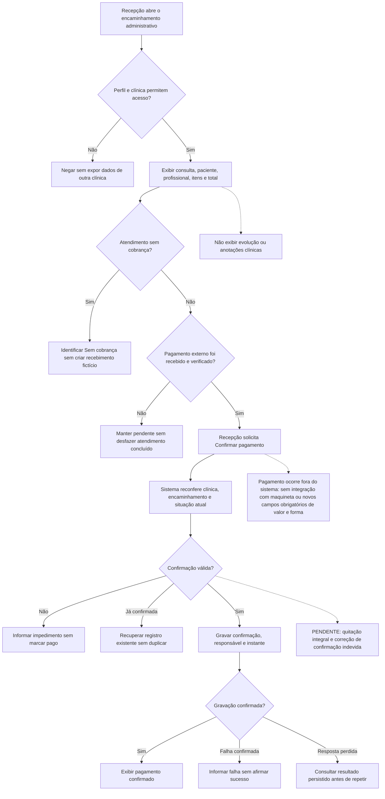
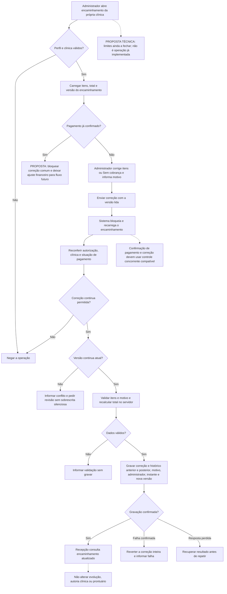

# Lumina Odonto — Fluxogramas complementares em Mermaid

**Data:** 02/11/2026. **Versão documental:** 0.4.\
**Fonte:** [especificação funcional](fluxo-atendimento-mvp-2026-11-02.md).

Cole cada bloco separadamente no Mermaid. O fluxo 5 abaixo substitui o anterior com valor recebido e forma de pagamento. O fluxo 6 é adicional: administrador é o responsável indicado, mas os limites de correção ainda são proposta técnica. Os desenhos não comprovam implementação ou teste.

## 5. Pagamento externo e confirmação pela recepção

## 6. Correção administrativa de serviços — limites propostos

**Para o backend:** a correção, seu histórico e a atualização da versão devem ter a mesma fronteira transacional. Pagamento confirmado durante a edição deve ser percebido na gravação. A versão é do encaminhamento administrativo, não da evolução. Erros não incluem conteúdo clínico. Detalhar rotas e códigos antes de implementar; não tratá-los como contratos atuais.

**Para a documentação:** substituir o fluxo financeiro anterior, manter os rótulos de proposta e pendência e identificar a versão no PDF. Argon2/paralelismo permanece somente sugestão para avaliar possibilidade de implementação, sem promessa de entrega ou resultado medido.
