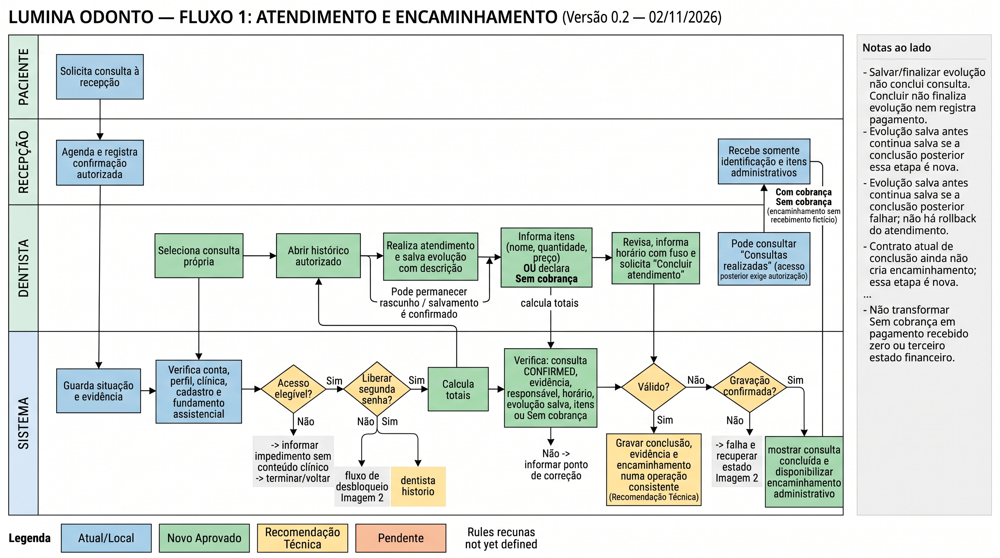
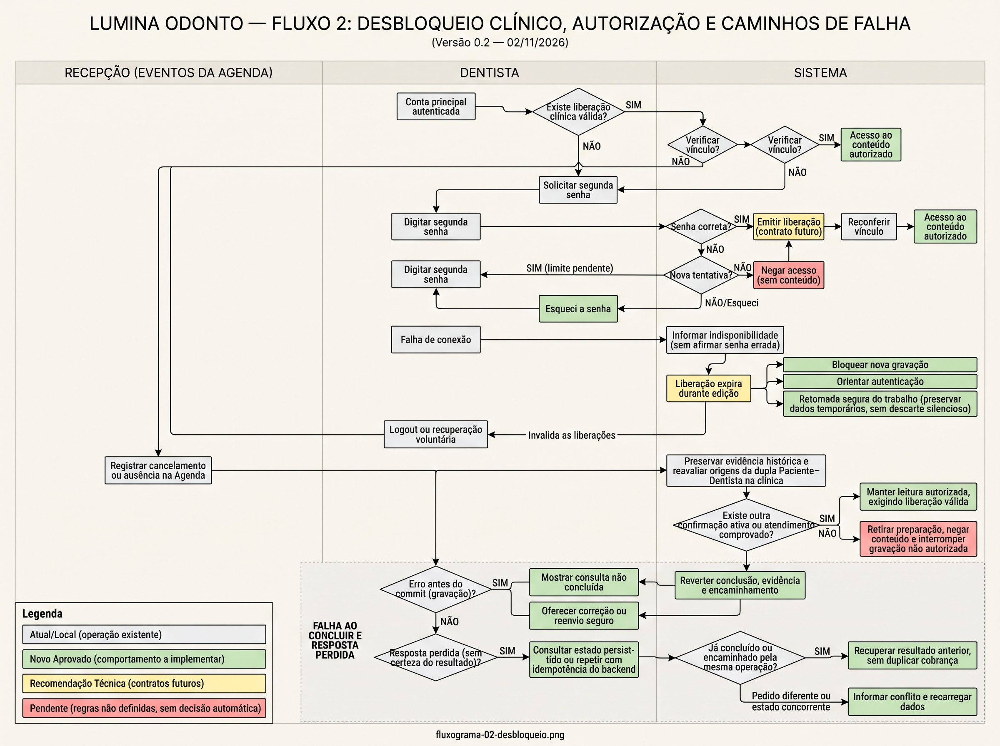
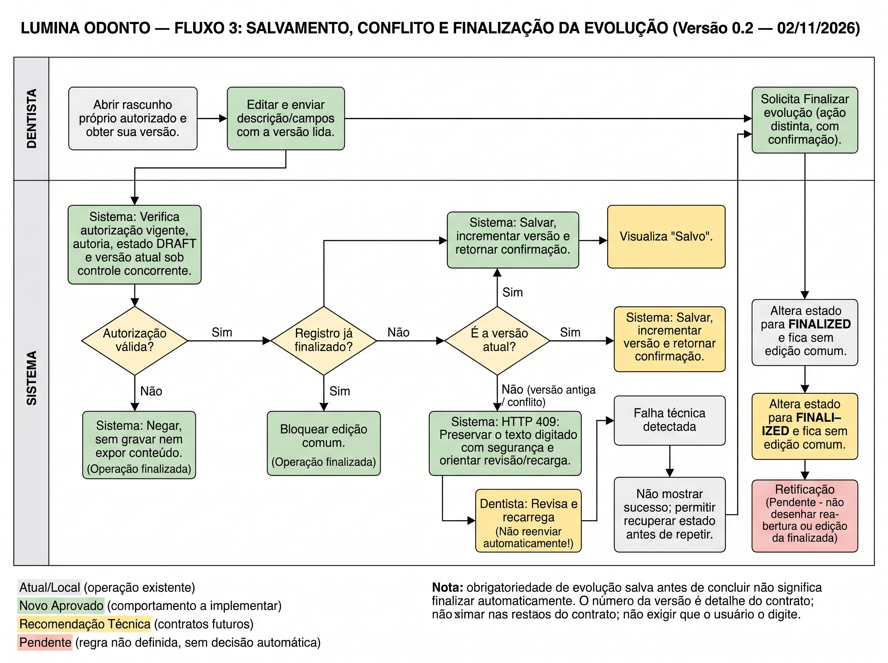
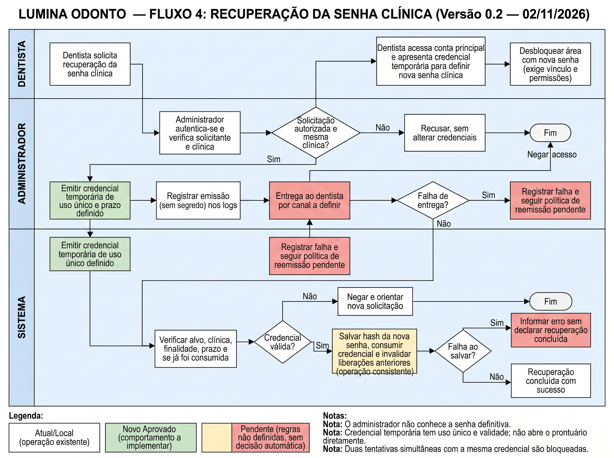
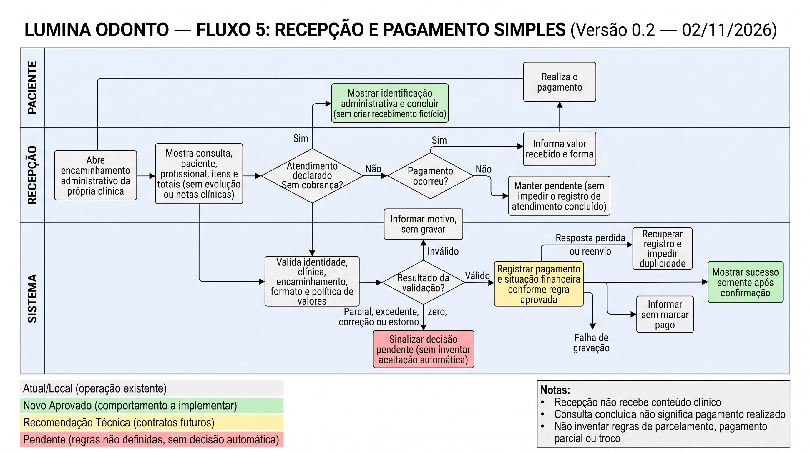

# Lumina Odonto — Sprint 08: consolidação parcial e planejamento de conclusão

**Data de elaboração:** 02/11/2026. **Destinatários:** Paulo Sérgio e Cassiano Augusto, para a documentação cumulativa. **Natureza:** capítulo técnico parcial, sujeito à revisão da equipe; não é aceite acadêmico nem relatório de execução de testes desta elaboração.

**Projeto:** Lumina Odonto. **Grupo:** número não localizado nas fontes examinadas; Paulo/Cassiano devem confirmá-lo antes do PDF oficial. **Integrantes conforme [README do projeto](../../../../README.md):** Caio Cesar; Cassiano Augusto Brito de Souza; João Vitor Lima Rocha; Luiz Otávio de Souza Azevedo; Paulo Sérgio Barros de Souza; Tarcísio Alves Viana Costa Filho. A minuta geral das Sprints 1–6 disponível fora do repositório omite Caio na capa; sua identificação exige revisão.

**Marco informado para a Sprint 08:** 31/10/2026. O enunciado oficial e o início formal do período ainda não foram fornecidos; o confronto com as exigências abaixo é **provisório**, baseado nas quatro categorias informadas por Paulo: funcionalidades integradas, permissões, usabilidade e revisão das regras. As evidências técnicas de 23–28/10 servem de base anterior; o QA é de 31/10; a especificação funcional v0.4 e as cinco imagens recebidas são de 02/11, **após o prazo informado**. A data exata de cada correção local posterior ao QA não foi comprovada por commit.

**Versão examinada:** `/home/paulinho/Work/Projeto_clinica`, branch `chore/sprint-07-docker-integration`, HEAD `2f7dbfe6d0d7a747f57dbeeede3a716938adc5fa` (28/10), com alterações locais sem commit em backend, SQL, testes e documentação. O rastreador local `origin/chore/sprint-07-docker-integration` aponta ao mesmo hash; isso **não confirma** o estado remoto em 02/11. O [PR #16](https://github.com/0Tavinn/Projeto_clinica/pull/16) foi identificado como aberto e com esse HEAD no início do QA de 31/10, segundo o relatório de QA; seu estado atual não foi reconfirmado nesta elaboração.

## 1. Resumo da situação

O objetivo informado da Sprint 08 era entregar funcionalidades integradas, revisar permissões e regras e melhorar a usabilidade até 31/10. A branch já reunia, de ciclos anteriores, frontend clínico, API de Agenda/prontuário, evidências de confirmação e realização e Compose com PostgreSQL. O [QA de 31/10](../../qa/2026-10-31-2f7dbfe/relatorio-qa-sprint07.md), executado na base `2f7dbfe`, comprovou vários caminhos HTTP e de persistência em ambiente descartável, mas encontrou defeitos de concorrência, incompatibilidade entre cliente e API e entregas de painel/relatório/histórico ainda sem demonstração. **O executor foi o agente de QA, não João Vitor.**

Paulo conduziu correções locais de backend para QA-01 e QA-02 após o ensaio; o código agora contém bloqueio e reconferência da autorização, além de controle de versão do rascunho. Os testes posteriores de SQLite, PostgreSQL e da migração foram **informados pelo backend** nos repasses recebidos. Não existe revalidação independente do QA para essa árvore local; Paulo a previu para a próxima sprint, sem atribuir compromisso confirmado a outro integrante.

Em 02/11, a equipe refinou documentalmente o fluxo completo de atendimento e as interfaces necessárias. A [especificação funcional v0.4](../../../especificacoes/fluxo-atendimento-mvp-2026-11-02.md) organiza segunda senha clínica, evolução antes da conclusão, serviços, pagamento externo e correção administrativa. Trata-se de **planejamento de conclusão posterior ao prazo**, com novas operações ainda não comprovadas em execução. Os fluxogramas JPG recebidos são v0.2 e servem apenas de memória do desenho; o fluxo 5 contradiz expressamente a v0.4.

**Situação geral:** base integrada e fluxos clínicos delimitados demonstrados em `2f7dbfe`; correções críticas de backend presentes apenas localmente e testadas segundo o backend; frontend e fluxo composto de atendimento incompletos; aceite integral da Sprint 08 não comprovado.

## 2. Entregas práticas e limites da evidência

| Entrega | Versão e fonte | Situação comprovável | Limite |
| --- | --- | --- | --- |
| Inicialização da API e Docker com PostgreSQL | `ab129d7` e `9b26c81`; [registro de integração](../../../sprint/sprint-07-docker-integration.md); QA `2f7dbfe` | API, frontend servido e PostgreSQL 16.15 funcionaram em ambiente descartável do QA; persistência foi verificada após reinício e recriação sem remover o volume de teste. | Não demonstra a árvore local posterior nem migração, backup/restauração ou funcionamento do banco existente da equipe. |
| Agenda, confirmação, conclusão e evidências | `be7c2f2`, `ac180a7`, `ef15a63`; [relatório QA](../../qa/2026-10-31-2f7dbfe/relatorio-qa-sprint07.md); [serviço](../../../../backend/app/appointments/service.py) | HTTP e SQL da base `2f7dbfe` demonstraram confirmação autorizada e conclusão pelo dentista responsável após `CONFIRMED`, com horário informado e evidências persistidas. | A interface ainda envia somente `{status}` para concluir e não fornece `care_occurred_at` com fuso; QA-03 permanece. A conclusão atual não exige evolução salva nem itens/`Sem cobrança`. |
| Prontuário e evoluções | `b224faa`, `34b128f` e correções posteriores; [API](../../../../backend/app/records/service.py); QA `2f7dbfe` | QA verificou leitura por dentista elegível, isolamento por clínica, rascunho próprio, finalizadas compartilhadas, finalização explícita e recuperação após reinício no ambiente de teste. | O `GET /record` atual pode abrir o prontuário; D02 continua aberta. A segunda senha e o fluxo administrativo não estão implementados. |
| QA-01 e QA-02 | Diferenças locais em `access_repository.py`, `models.py`, `schemas.py`, `service.py`, `schema.sql`, testes e migração de 31/10; [fechamento parcial anterior](../../sprint-07/relatorio-estado-atual-fechamento-parcial-sprint-07-2026-10-31.md) | Código local inspecionado contém as duas correções; o backend informou testes posteriores. | Sem commit, imagem integrada ou revalidação independente. Migração preparada não aplicada ao banco existente. |
| Contratos HTTP | `2f7dbfe`; [Agenda](../../../../backend/app/appointments/README.md) e [records](../../../../backend/app/records/README.md) | Guias da API existentes; o guia clínico local descreve `version`. | O README local da Agenda ainda contém a afirmação histórica de que QA-02 não tem controle de versão; precisa ser alinhado ao código local antes de publicação. |
| Dashboard, filtros e pesquisa | [frontend](../../../../frontend/src/App.tsx), [plano da Sprint 7](../../../sprint/sprint-07.md) e QA | Dashboard existia desde a Sprint 4; busca local de pacientes e filtros HTTP da Agenda foram encontrados. | Indicadores novos de consultas por situação/período não foram demonstrados; três verificações visuais em navegador não foram executadas. |

O dashboard **não foi criado nesta sprint**: o primeiro commit comprovado nesta linha local é `e3d9393` (25/09, Sprint 4), inicialmente com números de demonstração; `d806382` (26/09) integrou contagem de pacientes da API, perfil e equipe. A minuta geral até a Sprint 6 o apresenta na Sprint 4 (Figura 29, página física 74), conforme [análise anterior](../../sprint-07/relatorio-estado-atual-fechamento-parcial-sprint-07-2026-10-31.md). Essa existência não atende aos novos indicadores de consultas.

## 3. QA de 31/10, defeitos e correções posteriores

A [matriz CSV](../../qa/2026-10-31-2f7dbfe/matriz-testes.csv) contém **209 verificações: 197 aprovadas, 8 reprovadas, 1 bloqueada e 3 não executadas em navegador**. As linhas reprovadas incluem sondagens distintas dos defeitos agrupados abaixo; não se deve confundir oito linhas com oito IDs. O ensaio usou dados fictícios e PostgreSQL 16.15 descartável. O QA não executou clique visual em navegador e não testou as correções posteriores.

| Achado na base `2f7dbfe` | Reprodução e impacto resumidos | Situação posterior |
| --- | --- | --- |
| **QA-01 — escrita após perder a última autorização** | Mutação clínica esperou bloqueio da evolução; a última confirmação foi cancelada; edição/finalização ainda retornaram `200`, embora leitura posterior fosse `403`. Risco de alterar registro sem vínculo vigente. | Código local bloqueia consultas de origem e reconfere autorização após a espera, até commit/rollback; backend informou ensaios PostgreSQL. **Revalidação independente pendente.** |
| **QA-02 — sobrescrita silenciosa** | Duas edições do mesmo rascunho retornaram `200/200`, com perda do primeiro texto. | Código local exige `version` inteiro positivo no PATCH; edição aceita incrementa, versão antiga recebe `409`, ausência ou valor inválido recebe `422`; finalização sem corpo incrementa a versão. **Revalidação independente pendente.** |
| **QA-03 — cliente não conclui conforme contrato** | `frontend/src/api.ts` envia só `{status}`; API exige `care_occurred_at` com fuso e respondeu `422` para esse corpo. | Sem ajuste do frontend identificado. Falha de contrato, sem clique visual de QA. |
| **QA-04 — limite de login** | Com configuração de 100/minuto, sexta tentativa fictícia recebeu `429`; código fixa cinco. | Sem correção local identificada. |
| **QA-05 — histórico funcional** | Após operações no ambiente QA, `audit_logs=0` e nenhuma rota de leitura apareceu. | Tabela SQL existente não prova histórico; entrega não demonstrada. |
| **QA-06 — indicadores de consultas** | Código e bundle mostraram painel de pacientes/perfil/equipe, sem agregado de consultas por situação e período. | Melhoria não demonstrada; dashboard anterior preservado. |
| **QA-07 — relatório de agendamentos** | Sem view correspondente e sem rota identificada no bundle/OpenAPI testado. | Relatório não demonstrado. |

O backend informou, para a árvore local posterior, **82 testes SQLite aprovados, 10 pulados exclusivos de PostgreSQL e 10 testes PostgreSQL 16.15 aprovados**, além de ensaio da migração `version` em banco descartável após ajustar o nome do banco de teste. O primeiro ensaio de migração falhou por essa exigência do ambiente e a repetição passou. Os repasses estão transcritos no [relatório de fechamento parcial da Sprint 7](../../sprint-07/relatorio-estado-atual-fechamento-parcial-sprint-07-2026-10-31.md); logs finais independentes não foram anexados aqui. **Esses números não são nova execução deste relatório, não se somam às 209 linhas e não encerram os defeitos perante QA.**

A migração incremental de `version` está [preparada](../../../../backend/database/migrations/20261031_add_clinical_evolution_version.sql), sem aplicação no banco existente. A versão 1 atribuída a registros antigos é a base do novo protocolo, não contagem retroativa de edições. Consumidores da API precisam guardar/enviar `version` e tratar `409`; o frontend atual ainda não o faz, de modo que sua edição receberá `422` se a API local for ativada após a migração. O escopo do ensaio descartável não demonstra segurança para esquema Alembic, misto ou volume da equipe.

## 4. Planejamento de conclusão do atendimento — decisões de 02/11

A [especificação v0.4](../../../especificacoes/fluxo-atendimento-mvp-2026-11-02.md) e o [roteiro](../../../especificacoes/roteiro-fluxogramas-mvp-2026-11-02.md) alinham protótipo, API, banco e testes futuros. As decisões de Paulo abaixo são **direção funcional aprovada**, não funcionalidades entregues até 31/10:

1. Paciente participa fora da plataforma; não há portal neste recorte. Dentista usa senha principal e segunda senha clínica **pessoal**, que não substitui vínculo assistencial, perfil ou clínica.
2. Recuperação usa credencial temporária com validade e uso único; administrador não conhece a senha clínica definitiva. Prazo, canal e verificação de identidade continuam pendentes.
3. Para concluir, o dentista deve ter evolução **salva com descrição**, mesmo que permaneça `DRAFT`. Finalizar evolução e concluir consulta são ações distintas; não há finalização automática.
4. O dentista informa itens administrativos com nome, quantidade e preço ou declara explicitamente **Sem cobrança**. Lista vazia não é declaração de gratuidade. A operação conjunta de conclusão, realização e encaminhamento é **recomendação técnica** ainda sem implementação demonstrada.
5. Pagamento ocorre fora do sistema. A recepção confirma o recebimento e o registro identifica responsável e instante. Concluir a consulta não registra pagamento. A v0.4 **não exige novos campos de valor recebido ou forma de pagamento**.
6. Paulo indicou administrador para correção de serviços. Bloqueio após pagamento, motivo, histórico e versionamento do encaminhamento são **limites técnicos propostos**, ainda sujeitos a decisão; essa correção não altera evolução clínica.
7. Paralelismo de Argon2 é **somente sugestão para avaliar** a possibilidade acadêmica; não há mudança, benchmark ou ganho comprovado.

O contrato futuro deve separar respostas clínicas de dados administrativos acessíveis à recepção; prever falha, concorrência, reenvio sem duplicidade, confirmação perdida e rastreabilidade. Nada disso substitui a implementação e os testes em versão identificada.

### 4.1 Inventário e leitura das cinco imagens recebidas

As cópias preservam os arquivos JPG recebidos em 02/11, sem redesenho. **Todas trazem “Versão 0.2” na própria imagem.** Suas figuras representam **funcionamento planejado**, nunca execução do sistema. A coluna de ressalvas governa a leitura em relação à v0.4; em caso de conflito, vale a especificação textual v0.4.

| Figura recebida | Correspondência | Coerência e ressalva |
| --- | --- | --- |
| Figura 1 — `Fluxo 1.jpg` | Atendimento e encaminhamento | Mostra evolução, itens/`Sem cobrança` e conclusão distinta de pagamento, mas é v0.2, tem setas e decisões de validação ambíguas e não comprova transação implementada. |
| Figura 2 — `Fluxo 2.jpg` | Desbloqueio, autorização e falhas | Traz senha clínica, reavaliação de origem e resposta perdida como plano; contém verificações repetidas e contratos futuros sem definição. Não comprova segunda senha existente. |
| Figura 3 — `Fluxo 3.jpg` | Evolução e conflitos | Representa conflito de versão e finalização separada, mas repete etapas e mistura classificação de código local e proposta. O `version` local continua sem QA independente. |
| Figura 4 — `Fluxo 4.jpg` | Recuperação da senha clínica | Inclui credencial temporária, uso único e senha definitiva invisível ao administrador; apresenta caixas duplicadas de emissão e depende de canal e prazo ainda indefinidos. |
| **Figura 5 — `Fluxo 5.jpg`** | Pagamento | **Desatualizada e incompatível com a v0.4:** pede valor recebido e forma, valida política de valores e sugere registro financeiro mais amplo. A v0.4 aprovou confirmação simples do recebimento externo, com ator e instante, sem esses novos campos. Não usar esta figura como regra atual. |

**Fluxo 6 — correção administrativa de serviços:** não houve imagem recebida. Paulo orientou utilizar apenas as cinco imagens acima; a direção aprovada e os limites propostos são descritos em texto a partir do [complemento v0.4](../../../especificacoes/fluxogramas-complementares-mvp-2026-11-02.md), sem gerar ou substituir a figura ausente.

## 5. Permissões, usabilidade e regras

**Controle encontrado e ensaiado em `2f7dbfe`:** API restringe conteúdo clínico a dentista ativo com cadastro profissional, mesma clínica e origem assistencial válida; rascunhos são privados ao autor e finalizadas são compartilhadas com dentistas elegíveis. A Agenda separa confirmação/cancelamento/ausência autorizadas da conclusão pelo dentista responsável, após confirmação confiável. O QA cobriu perfis, duas clínicas e fundamentos de acesso, mas revelou QA-01 sob concorrência. **Controle local posterior:** bloqueio das origens e reconferência após espera; ainda requer revalidação independente. **Propostas novas:** segunda senha clínica, recuperação, recorte administrativo para recepção e correção de serviços pelo administrador. A senha clínica jamais amplia o conjunto de pacientes autorizados.

**Usabilidade existente:** frontend possui dashboard, Agenda, filtros e telas clínicas herdadas; a pesquisa local de pacientes foi encontrada. O QA não executou navegação visual em navegador. O protótipo proposto organiza consultas próprias, prontuário, evolução, serviços, consultas realizadas e confirmação de recebimento pela recepção, distinguindo salvar, finalizar, concluir e pagar. Estados de carregamento, conflito, expiração e falha são **orientações de desenho**, não melhorias validadas por usuários. QA-03 e a ausência de `version` no cliente impedem tratar o fluxo atual como integrado.

**Regras e IDs existentes:** RF-022 e RN-024/RN-025 tratam estados e conclusão da Agenda; RF-023/RN-031 tratam preparação por confirmação ativa, continuidade por realização comprovada e leitura clínica; RF-024/RN-032 tratam evoluções, autoria, privacidade e preservação. RF-025/RN-033 continuam proposta de IA. A decisão de 02/11 acrescenta pré-requisito de evolução salva e itens/`Sem cobrança` ao fluxo pretendido, com impacto em frontend, contrato da API e modelagem/persistência administrativa. Os [catálogos](../../../requirements.md) e [índices](../../../requisitos/README.md) locais ainda contêm trechos datados de 25/10 que chamam parte da política já codificada em 26/10 de “implementação pendente”; precisam de reconciliação documental própria antes de citação como fotografia atual. Não se criam IDs novos nem se altera requisito canônico neste relatório.

## 6. Confronto provisório com as exigências informadas da Sprint 08

**Limite:** sem o enunciado oficial, esta matriz cobre apenas as quatro categorias e o prazo informados por Paulo. Cassiano deve substituí-la ou completá-la contra o texto acadêmico antes da entrega oficial. Planejamento posterior a 31/10 não substitui prova prática no prazo.

| Exigência informada | Entrega e evidência disponível | Situação | Lacuna | Próxima ação proposta |
| --- | --- | --- | --- | --- |
| Funcionalidades integradas | Compose/API/Agenda/prontuário no QA `2f7dbfe`; 209 verificações; QA-01/02 corrigidos só localmente | **Parcial** | Cliente não conclui pelo contrato; fluxo com evolução prévia, serviços, encaminhamento e pagamento externo não demonstrado; banco existente não migrado | Alinhar contratos e cliente, implementar recorte aprovado e repetir testes em versão integrada identificada. |
| Permissões | QA de perfis, clínica, vínculo e autoria; RN-031; QA-01 detectado; correção local | **Parcial** | Revalidação independente de QA-01 pendente; segunda senha e permissões administrativas futuras ainda sem contrato | Fechar decisões, implementar controles na API e repetir cenários de concorrência e acesso por perfil/clínica. |
| Usabilidade | Dashboard anterior, Agenda, filtros e telas clínicas; inspeção de código/bundle | **Parcial, sem validação visual** | QA-03, indicadores novos, relatório e três ensaios em navegador pendentes; protótipo v0.4 é planejamento | Ajustar cliente, obter protótipo consistente e registrar demonstração em navegador com dados fictícios. |
| Revisão das regras de negócio | RF-022/023/024, RN-024/025/031/032 e especificação v0.4 | **Revisão documental parcial** | Decisões de 02/11 são posteriores ao prazo; índices antigos divergem do código; regras de quitação/correção ainda abertas | Confirmar enunciado, harmonizar documentos canônicos em etapa autorizada e vincular decisões, código e testes. |

## 7. Dificuldades, prioridades e condições de conclusão

| Prioridade | Pendência e motivo | Frente/responsável proposto, sem compromisso individual confirmado | Evidência necessária |
| --- | --- | --- | --- |
| 1 | QA-01/QA-02 locais sem commit, migração no banco existente ou revalidação independente | Paulo/backend, DBA e QA | Commit identificado, migração autorizada em destino inventariado e ensaios independentes PostgreSQL com estado persistido. |
| 2 | Cliente incompatível com `care_occurred_at` e `version` | Frontend (Caio/Otávio) com backend | Payloads, tratamento `409`/`422`, demonstração em navegador e QA na mesma versão. |
| 3 | Contratos e dados novos da v0.4 ainda sem implementação | Paulo para decisões, frontend, backend e banco | Protótipo revisado, contrato administrativo separado, migração e cenário ponta a ponta testado. |
| 4 | QA-04/05/06/07, exportação bloqueada por decisão e três cenários visuais não executados | Equipe por área; QA reexecuta após correção | Evidência de limite de login, histórico, indicadores, relatório e decisão/justificativa de CSV; capturas fictícias. |
| 5 | Numeração do grupo, enunciado Sprint 08 e cumulativo final | Paulo e Cassiano | Enunciado, número do grupo, arquivo geral editável, seções anteriores revisadas, figuras/referências e comprovante de entrega. |

Paulo informou que a revalidação independente de QA-01/QA-02 fica **prevista para a próxima sprint**. Não há prazo individual novo, aceite coletivo, aprovação da disciplina ou garantia de disponibilidade atribuída neste capítulo. O fluxo planejado deve ser reavaliado com o enunciado acadêmico; mudança de planejamento não dispensa exigência sem aprovação expressa.

## 8. Fontes e método

Fontes principais: [relatório de QA](../../qa/2026-10-31-2f7dbfe/relatorio-qa-sprint07.md) e [matriz](../../qa/2026-10-31-2f7dbfe/matriz-testes.csv); [fechamento parcial da Sprint 7](../../sprint-07/relatorio-estado-atual-fechamento-parcial-sprint-07-2026-10-31.md); [plano da Sprint 7](../../../sprint/sprint-07.md); [especificação funcional v0.4](../../../especificacoes/fluxo-atendimento-mvp-2026-11-02.md), [roteiro](../../../especificacoes/roteiro-fluxogramas-mvp-2026-11-02.md), [complemento](../../../especificacoes/fluxogramas-complementares-mvp-2026-11-02.md), [parecer backend](../../../especificacoes/pareceres-2026-11-02/backend.md), [parecer frontend](../../../especificacoes/pareceres-2026-11-02/frontend.md) e [parecer QA](../../../especificacoes/pareceres-2026-11-02/qa.md); [README da equipe](../../../../README.md); RF/RN e código ligados acima; histórico Git local; cinco JPGs fornecidos por Paulo. A minuta geral até a Sprint 6 foi consultada apenas para identificação e contexto histórico, sem declarar que represente o PDF final.

Esta elaboração fez **leitura documental e estática**, conferiu o CSV e as imagens e produziu o presente relatório. Não executou testes, build, navegador, contêineres, banco ou migração. Não confirmou o remoto atual, não publicou e não obteve aceite de Paulo, da equipe, de QA ou da disciplina.

## Anexo visual — imagens históricas fornecidas

**Aviso para todas as figuras:** JPGs originais v0.2, fornecidos em 02/11/2026; representam hipóteses e propostas de fluxo, não software executado. A v0.4 prevalece em caso de divergência. A numeração abaixo pertence somente a este capítulo e deve ser ajustada por Cassiano ao inserir as figuras no PDF cumulativo.

**Figura S08-1 — Fluxo 1: atendimento e encaminhamento (v0.2; planejamento histórico).** Ver item 4.1; conclusão e encaminhamento compostos ainda não demonstrados.

**Figura S08-2 — Fluxo 2: desbloqueio clínico, autorização e falhas (v0.2; planejamento histórico).** Segunda senha e recuperação ainda não implementadas.

**Figura S08-3 — Fluxo 3: evolução e conflitos (v0.2; planejamento histórico).** A correção local de `version` aguarda QA independente.

**Figura S08-4 — Fluxo 4: recuperação da senha clínica (v0.2; planejamento histórico).** Canal, prazo e verificação de identidade estão abertos.

**Figura S08-5 — Fluxo 5: pagamento (v0.2; DESATUALIZADO).** A figura pede valor recebido e forma; **não utilizar esse trecho como regra da v0.4**, que prevê somente confirmação do recebimento externo com responsável e instante, sem novos campos de valor e forma.

